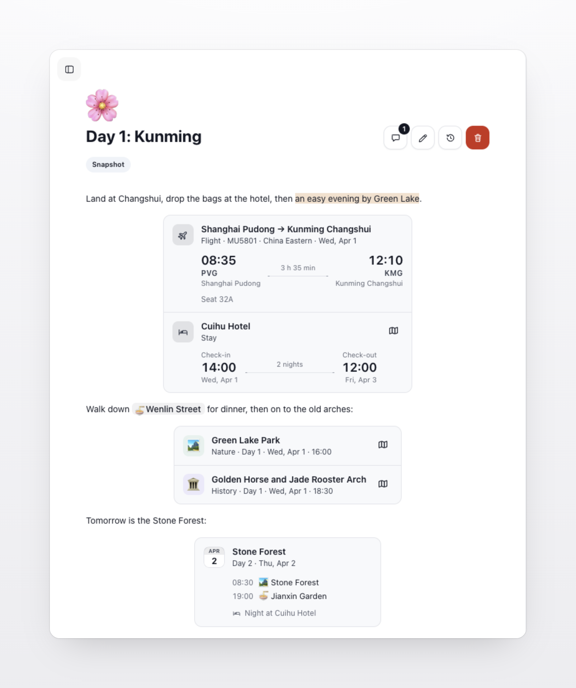

# Trip Fieldnotes

**English** | [简体中文](README.zh-CN.md)

**What your group needs to know, kept with the trip.**

Trip Fieldnotes adds a **Trip Fieldnotes** tab to every trip in [TREK](https://github.com/mauriceboe/TREK), the self-hosted trip planner. Transport tips, opening hours, packing lists: everyone travelling together finds them the moment they open the trip, instead of scrolling back through the group chat.

Works with TREK 4.1 or later, together with [Fieldnotes](https://github.com/Tangerineeew/fieldnotes) · Actively maintained, see [Releases](https://github.com/Tangerineeew/fieldnotes-trip/releases) · [MIT licence](./LICENSE)

## Screenshots

## What it does

Notes are written in Fieldnotes, your private travel notebook, and brought into each trip from there. Trip Fieldnotes is the trip's side: everyone on the trip reads and discusses them here, and people who can edit the trip arrange them and keep the trip's own copies up to date.

### Notes in the trip

<table>
<tr>
<td width="50%" valign="top">

<b>All in one tab</b> Every note shared with the trip is in the trip's Trip Fieldnotes tab, browsed in columns just like the Fieldnotes library, and as large in the same window: click a note to preview it, click again to open it. Open one and its properties, checklists, tables and images look exactly as they do in Fieldnotes.

<b>Source and day</b> The preview marks each note as a live reference or a snapshot, and shows the day a note was added for.

<b>Search and sorting</b> As in the Fieldnotes library, you can search titles, text and property values across the trip's notes, best matches first with the passage that matched, and sort by name, creation date or last change.

</td>
<td width="50%" valign="top"></td>
</tr>
</table>

### Live references and snapshots

<table>
<tr>
<td width="50%" valign="top">
<b>🔄 Live reference</b> Shows the author's current version in Fieldnotes, including later edits. If the original is deleted, or the author of a private note leaves the trip, it shows as "Reference unavailable".
</td>
<td width="50%" valign="top">
<b>📌 Snapshot</b> Keeps the version from when the note was added, with copies of its images and PDFs. Deleting the original, the author leaving the trip, or later edits to the original do not change it.
</td>
</tr>
</table>

### Organising

<table>
<tr>
<td width="33%" valign="top">
<b>🗂️ Trip folders</b> Create folders such as "Arrival" or "Day 1" for this trip, with sub-folders if you like. Drag notes into them, or right-click a note or folder for what you can do with it. These folders belong to the trip and do not affect anyone's own library; a folder can only be deleted once it is empty.
</td>
<td width="33%" valign="top">
<b>✏️ New note for this trip</b> "New note for this trip" opens the Fieldnotes editor. When you save, the note is kept in your library and added to the trip; if you had a trip folder open, the note goes into that folder too.
</td>
<td width="33%" valign="top">
<b>🗑️ Removing a note</b> Removing a note puts it in the trip's own Recently deleted, at the foot of the note list, with its comments and folder. It waits there for 30 days, ready to be recovered by anyone who can edit the trip, or deleted permanently. The original of a live reference stays in the library either way.
</td>
</tr>
</table>

### Editing snapshots

<table>
<tr>
<td width="50%" valign="top">
<b>✏️ Edit in the trip</b> People who can edit the trip can edit a snapshot right here: its icon, title, properties, text and images. Type <code>/</code> to drop in one of the trip's own PDFs, such as a booking confirmation, and read it right in the note. As in the Fieldnotes library, every change is saved as you type, several people can edit at once and see each other's cursors, and version history keeps earlier versions to read or bring back. The changes apply only to this trip's copy; the original in the author's library stays as it is.
</td>
<td width="50%" valign="top">
<b>📌 Turn a live reference into a snapshot</b> A live reference can be turned into a snapshot from the buttons beside the note's title, after which it no longer follows the author's edits. This follows the same rule as adding a snapshot: you need to be able to read the note in Fieldnotes yourself, so a private note shared live still disappears from the trip when its author leaves.
</td>
</tr>
</table>

### Trip items in your notes

<table>
<tr>
<td width="40%" valign="top"></td>
<td width="60%" valign="top">

<b>🗺️ Places, bookings, days and stays</b> While editing a snapshot, type <code>/</code> and choose "Trip item", or type <code>[[</code> and a name. In a sentence an item becomes a small tag; hover or tap it to see its card. On a line of its own it is the card: a place with its day and time, a flight or train with both ends, its clocks and the time in between, a dinner on its date, a stay with check-in, check-out and the nights, or a day with its stops in order and where you sleep. Items on lines right after one another share one box, like a list of the day's bookings or the places worth a detour; a blank line between them keeps them as separate cards. A click opens it in the trip's plan, and the map button opens Google Maps.

<b>🔄 Always current</b> Cards read the trip's plan again each time the note opens, so a changed time or a place moved to another day shows at once. An item since deleted from the trip's plan keeps its name, marked as removed. Confirmation numbers, prices and travellers never appear on a card, and copying the note as Markdown leaves just the names.

</td>
</tr>
</table>

### Comments

<table>
<tr>
<td width="45%" valign="top"></td>
<td width="55%" valign="top">

<b>On a passage or the whole note</b> Select text in a note and choose "Comment" to discuss that passage; the passage stays highlighted in the note, and clicking it opens its thread. You can also comment on the note as a whole.

<b>Threads</b> Each comment can collect replies and be marked as resolved, which moves it to the Resolved list where it can be reopened.

<b>Next to the note</b> Comments open in a panel on the note's right, where the note list opens on its left, so the note keeps its place while you read; on a phone they rise from the bottom. The comment button beside the title shows how many threads are still open.

<b>Part of this trip</b> Comments belong to the note in this trip. Turning a live reference into a snapshot keeps them; removing the note from the trip keeps them with it in Recently deleted, and they go only when it is deleted permanently.

</td>
</tr>
</table>

### Who can do what

<table>
<tr>
<td width="50%" valign="top">
<b>👀 Everyone on the trip</b> Can read the notes here, search and sort them, and comment, reply and resolve threads. Everyone can edit or delete their own comments.
</td>
<td width="50%" valign="top">
<b>🧭 People who can edit the trip</b> Can add or remove notes, arrange trip folders, edit snapshots, turn live references into snapshots and remove anyone's comments, following TREK's own trip editing permission.
</td>
</tr>
</table>

### Other details

<table>
<tr>
<td width="50%" valign="top">
<b>🌍 Languages</b> Follows TREK's language setting, in the same 27 languages as Fieldnotes, with a right-to-left layout for Arabic.
</td>
<td width="50%" valign="top">
<b>🗄️ No data of its own</b> Notes, trip links, snapshots and comments are stored by Fieldnotes, so uninstalling Trip Fieldnotes only removes the tab.
</td>
</tr>
</table>

## Permissions

Trip Fieldnotes asks for no permissions of its own. It shows and changes notes only through Fieldnotes, always acting as you, so it can read only the trips you are on and change only the ones you are allowed to edit. What Fieldnotes itself may access is listed in [its README](https://github.com/Tangerineeew/fieldnotes#permissions).

## Setup

1. Install and turn on [Fieldnotes](https://github.com/Tangerineeew/fieldnotes) first. Trip Fieldnotes needs it and will not run without it.
2. As an administrator, open **Admin → Plugins** in TREK. Find **Trip Fieldnotes** under **Discover** and install it, or download its ZIP file from this repository's Releases page and install it with **Upload plugin**. Then turn it on; new plugins start switched off.
3. Open any trip and choose the **Trip Fieldnotes** tab. Share notes from your Fieldnotes library with **Bring into a trip**, or start one here with **New note for this trip**.

## Good to know

- **What if Fieldnotes is missing?** TREK will not turn Trip Fieldnotes on, and offers to download Fieldnotes instead. Turning Fieldnotes off turns Trip Fieldnotes off with it.
- **Who can see the tab?** Everyone on the trip. Notes only appear once someone has shared them with the trip.
- **Who can change things?** Everyone on the trip can read and comment. People who can edit the trip in TREK can also add and remove notes, arrange folders and edit snapshots.
- **What if I uninstall Trip Fieldnotes?** Only the tab goes away. The notes, trip links, snapshots and comments belong to Fieldnotes and stay safe there.

## For developers

This repository holds the ready-to-install plugin. Its source code is kept with Fieldnotes, in the [`source/`](https://github.com/Tangerineeew/fieldnotes/tree/main/source) folder of that repository.

## License

[MIT](./LICENSE)
