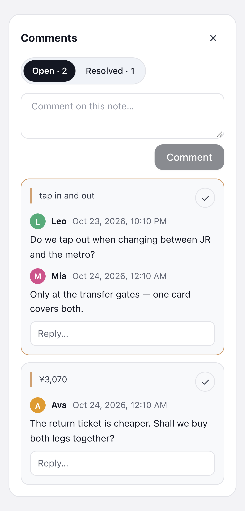

# Trip Fieldnotes

**English** | [简体中文](README.zh-CN.md)

What your group needs to know, kept with the trip.  
Trip Fieldnotes adds a **Trip Fieldnotes** tab to every trip in [TREK](https://github.com/mauriceboe/TREK), the self-hosted trip planner. Transport tips, opening hours, packing lists: everyone travelling together finds them the moment they open the trip, instead of scrolling back through the group chat.

It is the companion to [Fieldnotes](https://github.com/Tangerineeew/fieldnotes): notes are written in Fieldnotes, your private travel notebook, and you bring them into each trip.

## Screenshots

## What it does

Trip Fieldnotes covers the trip side: everyone on the trip reads and discusses the notes shared with it here, and people who can edit the trip arrange them and keep the trip's own copies up to date.

### Notes in the trip

<table>
<tr>
<td width="50%" valign="top">

<b>All in one tab</b> Every note shared with the trip is listed in the trip's Trip Fieldnotes tab. Open one and its properties, checklists, tables and images look exactly as they do in Fieldnotes.

<b>Source and day</b> Each note in the list is marked as a live reference or a snapshot, and a note that was added for a particular day shows that day.

<b>Search and sorting</b> As in the Fieldnotes library, you can search titles, text and property values in the current folder, and sort by name, creation date or last change.

</td>
<td width="50%" valign="top"></td>
</tr>
</table>

### Live references and snapshots

<table>
<tr>
<td width="50%" valign="top">
<b>🔄 Live reference</b> Shows the author's current version in Fieldnotes, including later edits. If the original is deleted, or the author of a private note leaves the trip, it shows as "Reference unavailable".
</td>
<td width="50%" valign="top">
<b>📌 Snapshot</b> Keeps the version from when the note was added, with copies of its images. Deleting the original, the author leaving the trip, or later edits to the original do not change it.
</td>
</tr>
</table>

### Organising

<table>
<tr>
<td width="33%" valign="top">
<b>🗂️ Trip folders</b> Create folders such as "Arrival" or "Day 1" for this trip, with sub-folders if you like. Drag notes into them from the folder view. These folders belong to the trip and do not affect anyone's own library; a folder can only be deleted once it is empty.
</td>
<td width="33%" valign="top">
<b>✏️ New note for this trip</b> "New note for this trip" opens the Fieldnotes editor. When you save, the note is kept in your library and added to the trip; if you had a trip folder open, the note goes into that folder too.
</td>
<td width="33%" valign="top">
<b>🗑️ Removing a note</b> Removing a live reference leaves the original note in the library untouched. Removing a snapshot deletes that snapshot, so make sure it is no longer needed.
</td>
</tr>
</table>

### Editing snapshots

<table>
<tr>
<td width="50%" valign="top">
<b>✏️ Edit in the trip</b> People who can edit the trip can edit a snapshot right here: its icon, title, properties, text and images. The changes apply only to this trip's copy; the original in the author's library stays as it is.
</td>
<td width="50%" valign="top">
<b>📌 Turn a live reference into a snapshot</b> A live reference can be turned into a snapshot from the note's toolbar, after which it no longer follows the author's edits. This follows the same rule as adding a snapshot: you need to be able to read the note in Fieldnotes yourself, so a private note shared live still disappears from the trip when its author leaves.
</td>
</tr>
</table>

### Comments

<table>
<tr>
<td width="40%" valign="top"></td>
<td width="60%" valign="top">

<b>On a passage or the whole note</b> Select text in a note and choose "Comment" to discuss that passage; the passage stays highlighted in the note, and clicking it opens its thread. You can also comment on the note as a whole.

<b>Threads</b> Each comment can collect replies and be marked as resolved, which moves it to the Resolved list where it can be reopened.

<b>Next to the note</b> Comments open in a panel beside the note, so the note keeps the full page while you read. The toolbar shows how many threads are still open.

<b>Part of this trip</b> Comments belong to the note in this trip. Turning a live reference into a snapshot keeps them; removing the note from the trip deletes them.

</td>
</tr>
</table>

### Who can do what

<table>
<tr>
<td width="50%" valign="top">
<b>👀 Everyone on the trip</b> Can read the notes here, search and sort them, and comment, reply and resolve threads. Everyone can edit or delete their own comments.
</td>
<td width="50%" valign="top">
<b>🧭 People who can edit the trip</b> Can add or remove notes, arrange trip folders, edit snapshots, turn live references into snapshots and remove anyone's comments, following TREK's own trip editing permission.
</td>
</tr>
</table>

### Other details

<table>
<tr>
<td width="50%" valign="top">
<b>🌍 Languages</b> Follows TREK's language setting, in the same fourteen languages as Fieldnotes, with a right-to-left layout for Arabic.
</td>
<td width="50%" valign="top">
<b>🗄️ No data of its own</b> Notes, trip links, snapshots and comments are stored by Fieldnotes, so uninstalling Trip Fieldnotes only removes the tab.
</td>
</tr>
</table>

## Permissions

Trip Fieldnotes asks for no permissions of its own. It shows and changes notes only through Fieldnotes, always acting as you, so it can read only the trips you are on and change only the ones you are allowed to edit. What Fieldnotes itself may access is listed in [its README](https://github.com/Tangerineeew/fieldnotes#permissions).

## Setup

1. Install and turn on [Fieldnotes](https://github.com/Tangerineeew/fieldnotes) first. Trip Fieldnotes needs it and will not run without it.
2. As an administrator, open **Admin → Plugins** in TREK. Find **Trip Fieldnotes** under **Discover** and install it, or download its ZIP file from this repository's Releases page and install it with **Upload plugin**. Then turn it on; new plugins start switched off.
3. Open any trip and choose the **Trip Fieldnotes** tab. Share notes from your Fieldnotes library with **Bring into a trip**, or start one here with **New note for this trip**.

## Good to know

- **Who can see the tab?** Everyone on the trip. Notes only appear once someone has shared them with the trip.
- **What if I uninstall Trip Fieldnotes?** Only the tab goes away. The notes, trip links, snapshots and comments belong to Fieldnotes and stay safe there.

## For developers

This repository holds the ready-to-install plugin. Its source code is kept with Fieldnotes, in the [`source/`](https://github.com/Tangerineeew/fieldnotes/tree/main/source) folder of that repository.

## License

[MIT](./LICENSE)
