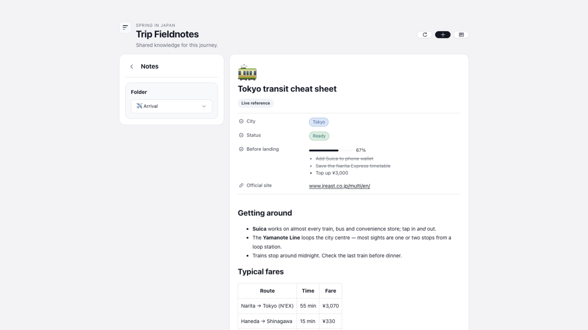
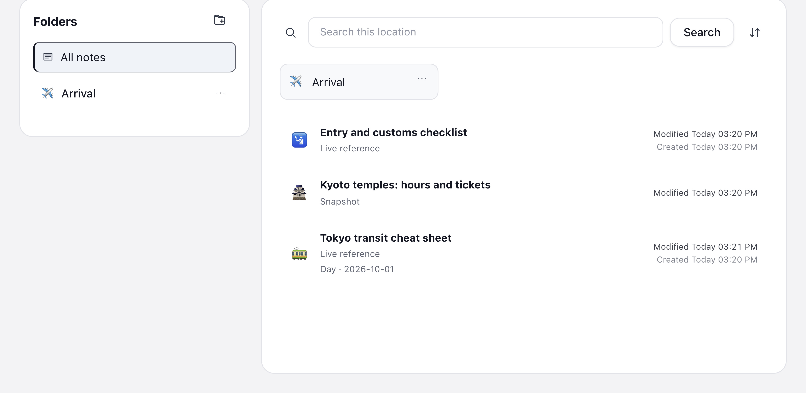
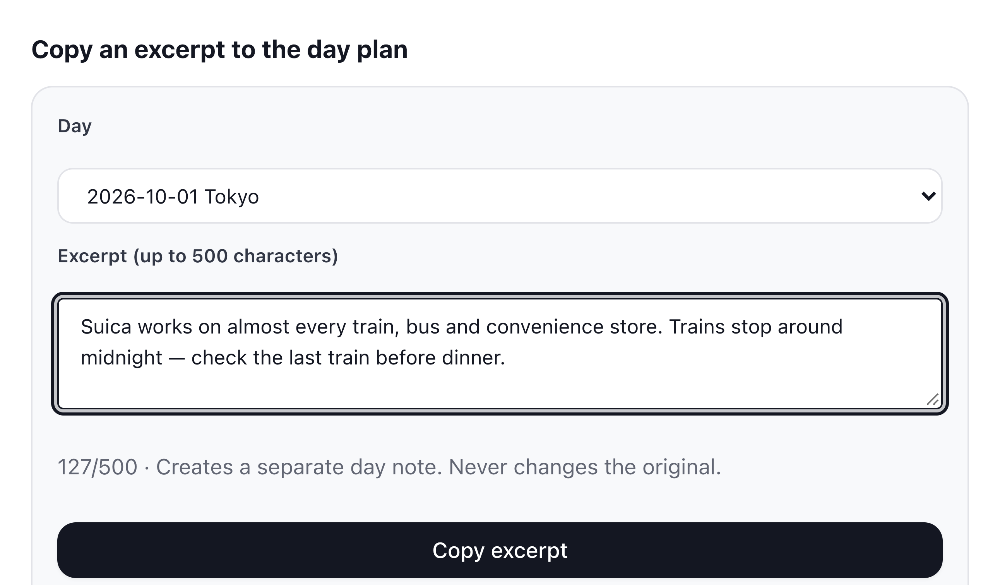

# Trip Fieldnotes

**English** | [简体中文](README.zh-CN.md)

What your group needs to know, kept with the trip.  
Trip Fieldnotes adds a **Trip Fieldnotes** tab to every trip in [TREK](https://github.com/mauriceboe/TREK), the self-hosted trip planner. Transport tips, opening hours, packing lists: everyone travelling together finds them the moment they open the trip, instead of scrolling back through the group chat.

It is the companion to [Fieldnotes](https://github.com/Tangerineeew/fieldnotes): notes are written in Fieldnotes, your private travel notebook, and you bring them into each trip.

## Screenshots

## What it does

Trip Fieldnotes covers the trip side: everyone on the trip reads the notes shared with it here, people who can edit the trip arrange them, and the useful parts go into the day plan.

### Notes in the trip

<table>
<tr>
<td width="50%" valign="top">

<b>All in one tab</b> Every note shared with the trip is listed in the trip's Trip Fieldnotes tab. Open one and its properties, checklists, tables and images look exactly as they do in Fieldnotes.

<b>Source and day</b> Each note in the list is marked as a live reference or a snapshot, and a note that was added for a particular day shows that day.

<b>Search and sorting</b> As in the Fieldnotes library, you can search titles, text and property values in the current folder, and sort by name, creation date or last change.

</td>
<td width="50%" valign="top"></td>
</tr>
</table>

### Live references and snapshots

<table>
<tr>
<td width="50%" valign="top">
<b>🔄 Live reference</b> Shows the author's current version in Fieldnotes, including later edits. If the original is deleted, or the author of a private note leaves the trip, it shows as "Reference unavailable".
</td>
<td width="50%" valign="top">
<b>📌 Snapshot</b> Keeps the version from when the note was added, with copies of its images. Deleting the original, the author leaving the trip, or later edits to the original do not change it.
</td>
</tr>
</table>

### Organising

<table>
<tr>
<td width="33%" valign="top">
<b>🗂️ Trip folders</b> Create folders such as "Arrival" or "Day 1" for this trip, with sub-folders if you like. Drag notes into them or pick a folder in the note's sidebar. These folders belong to the trip and do not affect anyone's own library; a folder can only be deleted once it is empty.
</td>
<td width="33%" valign="top">
<b>✏️ New note for this trip</b> "New note for this trip" opens the Fieldnotes editor. When you save, the note is kept in your library and added to the trip; if you had a trip folder open, the note goes into that folder too.
</td>
<td width="33%" valign="top">
<b>🗑️ Removing a note</b> Removing a live reference leaves the original note in the library untouched. Removing a snapshot deletes that snapshot, so make sure it is no longer needed.
</td>
</tr>
</table>

### Copying into the day plan

<table>
<tr>
<td width="50%" valign="top"></td>
<td width="50%" valign="top">

<b>Excerpts</b> While reading a note, you can copy part of it into a day of the trip. The excerpt box starts with the note's title and text (only the title if together they exceed 500 characters), and you can trim it to what you need, up to 500 characters.

<b>An ordinary day note</b> The excerpt appears in that day's plan as an ordinary day note, just like one you would add in TREK yourself.

<b>Independent of the original</b> The excerpt is its own copy: later edits to the original note or to the day note do not affect the other.

</td>
</tr>
</table>

### Who can do what

<table>
<tr>
<td width="33%" valign="top">
<b>👀 Everyone on the trip</b> Can read the notes here, and search and sort them.
</td>
<td width="33%" valign="top">
<b>🧭 People who can edit the trip</b> Can add or remove notes and create and arrange trip folders, following TREK's own trip editing permission.
</td>
<td width="33%" valign="top">
<b>📅 People who can edit days</b> Can copy excerpts into the day plan, following TREK's own day editing permission.
</td>
</tr>
</table>

### Other details

<table>
<tr>
<td width="50%" valign="top">
<b>🌍 Languages</b> Follows TREK's language setting, in the same fourteen languages as Fieldnotes, with a right-to-left layout for Arabic.
</td>
<td width="50%" valign="top">
<b>🗄️ No data of its own</b> Notes, trip links and snapshots are stored by Fieldnotes, so uninstalling Trip Fieldnotes only removes the tab.
</td>
</tr>
</table>

## Permissions

Trip Fieldnotes asks for no permissions of its own. It shows and changes notes only through Fieldnotes, always acting as you, so it can read only the trips you are on and change only the ones you are allowed to edit. What Fieldnotes itself may access is listed in [its README](https://github.com/Tangerineeew/fieldnotes#permissions).

## Setup

1. Install and turn on [Fieldnotes](https://github.com/Tangerineeew/fieldnotes) first. Trip Fieldnotes needs it and will not run without it.
2. As an administrator, open **Admin → Plugins** in TREK. Find **Trip Fieldnotes** under **Discover** and install it, or download its ZIP file from this repository's Releases page and install it with **Upload plugin**. Then turn it on; new plugins start switched off.
3. Open any trip and choose the **Trip Fieldnotes** tab. Share notes from your Fieldnotes library with **Bring into a trip**, or start one here with **New note for this trip**.

## Good to know

- **Who can see the tab?** Everyone on the trip. Notes only appear once someone has shared them with the trip.
- **What if I uninstall Trip Fieldnotes?** Only the tab goes away. The notes, the trip links and the snapshots belong to Fieldnotes and stay safe there.

## For developers

This repository holds the ready-to-install plugin. Its source code is kept with Fieldnotes, in the [`source/`](https://github.com/Tangerineeew/fieldnotes/tree/main/source) folder of that repository.

## License

[MIT](./LICENSE)
