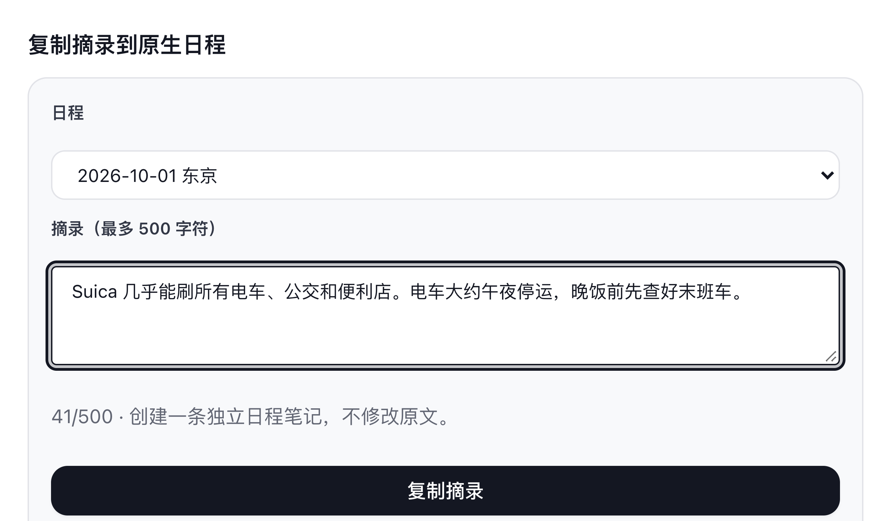

# Trip Fieldnotes

[English](README.md) | **简体中文**

同行的人需要知道的，都放在旅行里。  
Trip Fieldnotes 会在自托管旅行规划工具 [TREK](https://github.com/mauriceboe/TREK) 的每次旅行中添加一个 **Trip Fieldnotes** 标签页。交通攻略、开放时间、行前清单，同行的人打开旅行就能读到，不必再去群聊记录里翻找。

它是 [Fieldnotes](https://github.com/Tangerineeew/fieldnotes) 的配套插件：笔记写在 Fieldnotes 这本私人旅行笔记里，再由你带进每一次旅行。

## 截图

## 功能介绍

Trip Fieldnotes 负责旅行这一侧：同行的人在这里阅读分享给旅行的笔记，有编辑权限的人在这里整理它们，并把需要的内容放进日程。

### 旅行中的笔记

<table>
<tr>
<td width="50%" valign="top">

<b>集中阅读</b> 分享给这次旅行的笔记，都列在旅行的 Trip Fieldnotes 标签页里。打开一篇笔记，属性、清单、表格和图片的显示方式与在 Fieldnotes 中完全相同。

<b>来源与日期</b> 列表中的每篇笔记都标明是实时引用还是快照；带入时选择了日期的笔记，还会标注它属于哪一天。

<b>搜索与排序</b> 和 Fieldnotes 图书馆一样，可以在当前文件夹中搜索标题、正文和属性值，并按名称、创建时间或最近修改时间排序。

</td>
<td width="50%" valign="top"></td>
</tr>
</table>

### 实时引用与快照

<table>
<tr>
<td width="50%" valign="top">
<b>🔄 实时引用</b> 显示作者在 Fieldnotes 中的最新版本，作者之后的修改会同步过来。原笔记被删除，或作者退出了这次旅行（私有笔记），这条引用会显示为「引用已不可用」。
</td>
<td width="50%" valign="top">
<b>📌 快照</b> 保存加入旅行时的版本，图片也一并复制。原笔记被删除、作者退出旅行，或作者之后修改了原文，都不会影响快照的内容。
</td>
</tr>
</table>

### 整理

<table>
<tr>
<td width="33%" valign="top">
<b>🗂️ 旅行文件夹</b> 可以为这次旅行建立「抵达」「第一天」之类的文件夹，并支持子文件夹。笔记可以拖进文件夹，或在笔记侧栏中选择文件夹。这些文件夹只属于这次旅行，不影响任何人图书馆里的分类；只有清空了的文件夹才能删除。
</td>
<td width="33%" valign="top">
<b>✏️ 为此旅行新建笔记</b> 点击「为此旅行新建笔记」会打开 Fieldnotes 编辑器。保存后，笔记会存进你的图书馆，同时加入这次旅行；如果当时打开的是某个旅行文件夹，笔记也会放进这个文件夹。
</td>
<td width="33%" valign="top">
<b>🗑️ 从旅行移除</b> 移除实时引用不会影响图书馆中的原笔记。移除快照则会删除这份快照，请确认不再需要后再操作。
</td>
</tr>
</table>

### 复制到日程

<table>
<tr>
<td width="50%" valign="top"></td>
<td width="50%" valign="top">

<b>摘录</b> 阅读笔记时，可以把其中一段内容复制到旅行的某一天。摘录框会预先填好笔记的标题和正文（超过 500 字时只填标题），可以按需删改，最多 500 字。

<b>成为日程笔记</b> 复制后，摘录会作为一条普通的日程笔记出现在当天的行程中，和你在 TREK 里手动添加的日程笔记一样。

<b>原文不变</b> 摘录是独立的一份，之后修改原笔记或日程笔记，都不会影响另一方。

</td>
</tr>
</table>

### 谁可以做什么

<table>
<tr>
<td width="33%" valign="top">
<b>👀 所有成员</b> 旅行中的每个人都可以阅读这里的笔记，并使用搜索和排序。
</td>
<td width="33%" valign="top">
<b>🧭 可以编辑旅行的人</b> 可以带入或移除笔记、新建和整理旅行文件夹。这里沿用 TREK 本身的旅行编辑权限。
</td>
<td width="33%" valign="top">
<b>📅 可以编辑日程的人</b> 可以把摘录复制到日程中，同样沿用 TREK 的日程编辑权限。
</td>
</tr>
</table>

### 其他细节

<table>
<tr>
<td width="50%" valign="top">
<b>🌍 多语言</b> 跟随 TREK 的语言设置，支持的十四种语言与 Fieldnotes 相同，阿拉伯语为从右向左排版。
</td>
<td width="50%" valign="top">
<b>🗄️ 不保存数据</b> 笔记、旅行关联和快照都由 Fieldnotes 保存，卸载 Trip Fieldnotes 只会移除这个标签页。
</td>
</tr>
</table>

## 权限说明

Trip Fieldnotes 自身不申请任何权限。它只通过 Fieldnotes 来显示和修改笔记，并且始终以你的身份行事，所以只能读取你参加的旅行，也只能修改你有权编辑的旅行。Fieldnotes 本身能访问哪些内容，请参阅[它的说明](https://github.com/Tangerineeew/fieldnotes/blob/main/README.zh-CN.md#权限说明)。

## 安装与设置

1. 先安装并启用 [Fieldnotes](https://github.com/Tangerineeew/fieldnotes)。Trip Fieldnotes 依赖它，缺少它就无法运行。
2. 以管理员身份在 TREK 中打开 **管理后台 → 插件**，在「发现」中找到 **Trip Fieldnotes** 并安装；也可以从本仓库的 Releases 页面下载 ZIP 文件，用「上传插件」手动安装。安装后启用它，新安装的插件默认处于停用状态。
3. 打开任意一次旅行，选择 **Trip Fieldnotes** 标签页。可以在 Fieldnotes 图书馆中用 **带入旅行** 分享笔记，也可以在这里用 **为此旅行新建笔记** 直接开始写。

## 常见问题

- **谁能看到这个标签页？** 旅行中的所有人。只有当有人把笔记分享给这次旅行之后，笔记才会出现在这里。
- **卸载 Trip Fieldnotes 会怎样？** 只会移除这个标签页。笔记、旅行关联和快照都属于 Fieldnotes，会安然保留。

## 开发者

本仓库存放的是可以直接安装的插件，源代码与 Fieldnotes 放在一起，位于那个仓库的 [`source/`](https://github.com/Tangerineeew/fieldnotes/tree/main/source) 目录。

## 许可证

[MIT](./LICENSE)
