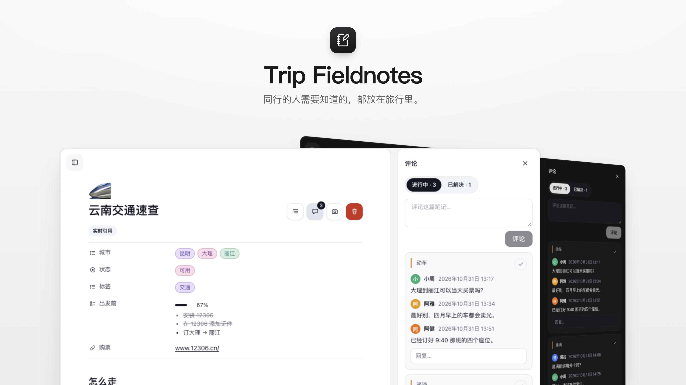
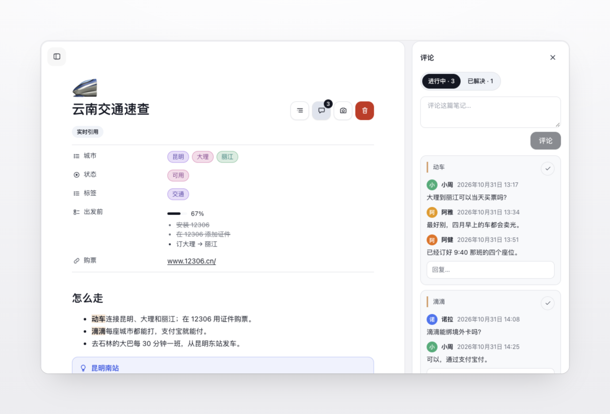

# Trip Fieldnotes

[English](README.md) | **简体中文**

**同行的人需要知道的，都放在旅行里。**

Trip Fieldnotes 会在自托管旅行规划工具 [TREK](https://github.com/mauriceboe/TREK) 的每次旅行中添加一个 **Trip Fieldnotes** 标签页。交通攻略、开放时间、行前清单，同行的人打开旅行就能读到，不必再去群聊记录里翻找。

适用于 TREK 4.1 及以上版本，需配合 [Fieldnotes](https://github.com/Tangerineeew/fieldnotes) 使用 · 持续维护中，见 [Releases](https://github.com/Tangerineeew/fieldnotes-trip/releases) · [MIT 许可证](./LICENSE)

## 截图

## 功能

笔记写在 Fieldnotes 这本私人旅行笔记里，再从那里带进每一次旅行。Trip Fieldnotes 负责旅行这一侧：同行的人在这里阅读和讨论，能编辑旅行的人在这里整理它们，并维护旅行自己的副本。

### 旅行中的笔记

<table>
<tr>
<td width="50%" valign="top">

<b>集中阅读</b> 分享给这次旅行的笔记，都在旅行的 Trip Fieldnotes 标签页里，和 Fieldnotes 图书馆一样分栏浏览，同一窗口下大小也相同：单击预览，再点一次打开。打开一篇笔记，属性、清单、表格和图片的显示方式与在 Fieldnotes 中完全相同。

<b>来源与日期</b> 预览里会标明每篇笔记是实时引用还是快照；带入时选择了日期的笔记，还会标注它属于哪一天。

<b>搜索与排序</b> 和 Fieldnotes 图书馆一样，可以在这次旅行的全部笔记中搜索标题、正文和属性值，最匹配的排在最前并显示命中的那一段，也可以按名称、创建时间或最近修改时间排序。

</td>
<td width="50%" valign="top"></td>
</tr>
</table>

### 实时引用与快照

<table>
<tr>
<td width="50%" valign="top">
<b>🔄 实时引用</b> 显示作者在 Fieldnotes 中的最新版本，作者之后的修改会同步过来。原笔记被删除，或作者退出了这次旅行（私有笔记），这条引用会显示为「引用已不可用」。
</td>
<td width="50%" valign="top">
<b>📌 快照</b> 保存加入旅行时的版本，图片和 PDF 也一并复制。原笔记被删除、作者退出旅行，或作者之后修改了原文，都不会影响快照的内容。
</td>
</tr>
</table>

### 整理

<table>
<tr>
<td width="33%" valign="top">
<b>🗂️ 旅行文件夹</b> 可以为这次旅行建立「抵达」「第一天」之类的文件夹，并支持子文件夹。把笔记拖进文件夹即可；右键点击笔记或文件夹，可以看到能对它做的操作。这些文件夹只属于这次旅行，不影响任何人图书馆里的分类；只有清空了的文件夹才能删除。
</td>
<td width="33%" valign="top">
<b>✏️ 为这次旅行新建笔记</b> 点击「为这次旅行新建笔记」会打开 Fieldnotes 编辑器。保存后，笔记会存进你的图书馆，同时加入这次旅行；如果当时打开的是某个旅行文件夹，笔记也会放进这个文件夹。
</td>
<td width="33%" valign="top">
<b>🗑️ 从旅行移除</b> 移除的笔记会连同评论和所在文件夹进入这次旅行自己的「最近删除」，位于笔记列表最下方。它会在那里保留 30 天，能编辑旅行的人可以随时恢复，或者永久删除。实时引用的原笔记始终留在图书馆中。
</td>
</tr>
</table>

### 编辑快照

<table>
<tr>
<td width="50%" valign="top">
<b>✏️ 在旅行中编辑</b> 可以编辑旅行的人，可以直接在这里修改快照的图标、标题、属性、正文和图片。输入 <code>/</code> 还能放入这次旅行里的 PDF，比如酒店预订确认，在笔记里直接阅读。和 Fieldnotes 图书馆一样，输入时随时自动保存，多人可以同时编辑并看到彼此的光标，版本历史会保留之前的版本，可以阅读或恢复。修改只作用于这次旅行中的副本，作者图书馆中的原文保持不变。
</td>
<td width="50%" valign="top">
<b>📌 把实时引用转为快照</b> 用笔记标题旁的按钮可以把实时引用转为快照，此后它不再同步作者的修改。规则与带入快照相同：你自己需要能在 Fieldnotes 中读到这篇笔记，因此以实时引用分享的私有笔记，在作者离开旅行后依然会从旅行中消失。
</td>
</tr>
</table>

### 笔记里的行程内容

<table>
<tr>
<td width="40%" valign="top"></td>
<td width="60%" valign="top">

<b>🗺️ 地点、预订、日程和住宿</b> 编辑快照时输入 <code>/</code> 选"行程内容"，或输入 <code>[[</code> 再打名称。写在句子里，它是一个小标签，悬停或轻点就能看到卡片；单独一行，它就是卡片本身：地点带第几天和时间；航班、火车显示两端的时刻和中间的时长；晚餐放在它的日期上；住宿显示入住、退房和几晚；某一天按顺序列出要去的地方，以及当晚住在哪里。紧挨着写的几项会合成一个框，比如抵达日要用的几张预订、顺路的几家店；中间空一行，就还是各自独立的卡片。点击卡片会在旅行的计划里打开它，地图按钮会打开 Google 地图。

<b>🔄 始终是最新的</b> 每次打开笔记，卡片都会重新读取旅行计划，时间改了、地点换到别的一天，都会马上反映出来。旅行计划里已经删掉的一项会保留名称，并标明已移除。卡片上从不显示确认号、价格和同行人，把笔记复制为 Markdown 时只留下名称。

</td>
</tr>
</table>

### 评论

<table>
<tr>
<td width="45%" valign="top"></td>
<td width="55%" valign="top">

<b>针对一段文字或整篇笔记</b> 在笔记中选中一段文字，点击「评论」即可针对它讨论；这段文字会在正文中保持高亮，点击高亮就能打开对应的讨论。也可以对整篇笔记发表评论。

<b>讨论串</b> 每条评论都可以回复，也可以标记为已解决，它会移到「已解决」列表中，需要时可以重新打开。

<b>在笔记旁边</b> 评论在笔记右侧的面板中打开，与左侧的笔记列表相对，阅读时笔记保持原位；在手机上则从底部升起。标题旁的评论按钮会显示还有多少条讨论未解决。

<b>属于这次旅行</b> 评论属于这次旅行中的这篇笔记。把实时引用转为快照时评论会保留；从旅行中移除笔记时，评论会随它一起留在「最近删除」里，直到永久删除才会删掉。

</td>
</tr>
</table>

### 谁可以做什么

<table>
<tr>
<td width="50%" valign="top">
<b>👀 所有成员</b> 旅行中的每个人都可以阅读这里的笔记、使用搜索和排序，也可以评论、回复和解决讨论。每个人都可以编辑或删除自己的评论。
</td>
<td width="50%" valign="top">
<b>🧭 可以编辑旅行的人</b> 可以带入或移除笔记、整理旅行文件夹、编辑快照、把实时引用转为快照，以及删除任何人的评论。这里沿用 TREK 本身的旅行编辑权限。
</td>
</tr>
</table>

### 其他细节

<table>
<tr>
<td width="50%" valign="top">
<b>🌍 多语言</b> 跟随 TREK 的语言设置，支持的 27 种语言与 Fieldnotes 相同，阿拉伯语为从右向左排版。
</td>
<td width="50%" valign="top">
<b>🗄️ 不保存数据</b> 笔记、旅行关联、快照和评论都由 Fieldnotes 保存，卸载 Trip Fieldnotes 只会移除这个标签页。
</td>
</tr>
</table>

## 权限

Trip Fieldnotes 自身不申请任何权限。它只通过 Fieldnotes 来显示和修改笔记，并且始终以你的身份行事，所以只能读取你参加的旅行，也只能修改你有权编辑的旅行。Fieldnotes 本身能访问哪些内容，请参阅[它的说明](https://github.com/Tangerineeew/fieldnotes/blob/main/README.zh-CN.md#权限)。

## 安装与设置

1. 先安装并启用 [Fieldnotes](https://github.com/Tangerineeew/fieldnotes)。Trip Fieldnotes 依赖它，缺少它就无法运行。
2. 以管理员身份在 TREK 中打开 **管理后台 → 插件**，在「发现」中找到 **Trip Fieldnotes** 并安装；也可以从本仓库的 Releases 页面下载 ZIP 文件，用「上传插件」手动安装。安装后启用它，新安装的插件默认处于停用状态。
3. 打开任意一次旅行，选择 **Trip Fieldnotes** 标签页。可以在 Fieldnotes 图书馆中用 **带入旅行** 分享笔记，也可以在这里用 **为这次旅行新建笔记** 直接开始写。

## 常见问题

- **没有安装 Fieldnotes 会怎样？** TREK 不会启用 Trip Fieldnotes，并会提示下载 Fieldnotes。停用 Fieldnotes 时，Trip Fieldnotes 也会随之停用。
- **谁能看到这个标签页？** 旅行中的所有人。只有当有人把笔记分享给这次旅行之后，笔记才会出现在这里。
- **谁能修改？** 旅行中的所有人都能阅读和评论。在 TREK 里能编辑这次旅行的人，还可以添加和移除笔记、整理文件夹、编辑快照。
- **卸载 Trip Fieldnotes 会怎样？** 只会移除这个标签页。笔记、旅行关联、快照和评论都属于 Fieldnotes，会安然保留。

## 开发者

本仓库存放的是可以直接安装的插件，源代码与 Fieldnotes 放在一起，位于那个仓库的 [`source/`](https://github.com/Tangerineeew/fieldnotes/tree/main/source) 目录。

## 许可证

[MIT](./LICENSE)
